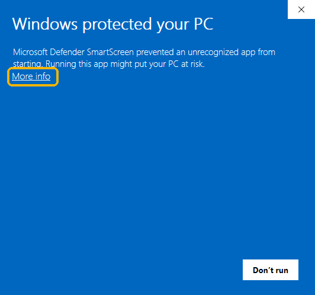
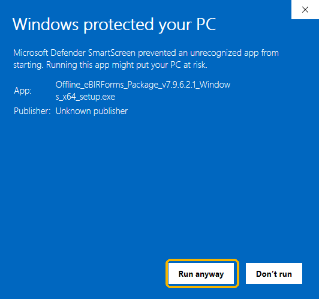
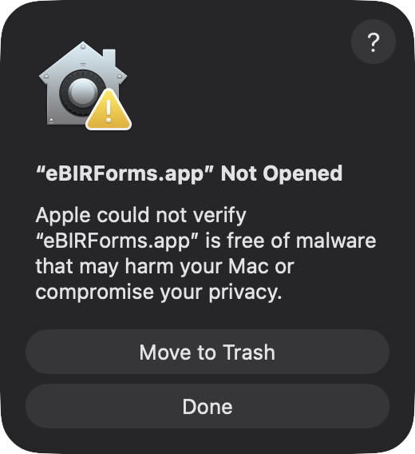
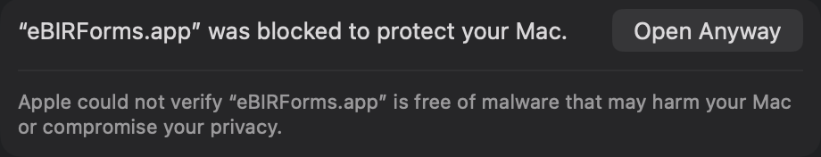
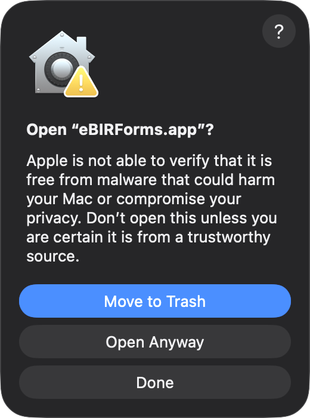
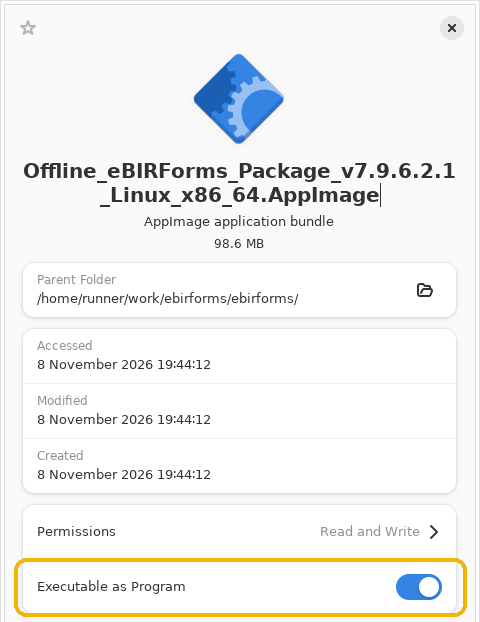

BIR's Offline eBIRForms Package, rebuilt to run on Windows, macOS and Linux. Fill in, check, save, print and send
BIR's 84 forms. The saved files are the same as BIR's own app makes. This app is free and not affiliated with BIR.
What's new in each version: [CHANGELOG](https://github.com/betterebirforms/ebirforms/blob/main/CHANGELOG.md).

## Which file do I download?

| Your computer | Download |
|---|---|
| Windows 10 or 11 | `..._Windows_x64_setup.exe` |
| Mac (Apple Silicon or Intel), macOS 12 or later | `..._macOS_universal.dmg` |
| Ubuntu, Debian, Linux Mint | `..._Linux_amd64.deb` |
| Any other Linux | `..._Linux_x86_64.AppImage` |

## Windows

1. Open the `setup.exe` you downloaded.
2. If Windows shows **Windows protected your PC**, click **More info**, then **Run anyway**. Windows shows this for
   new apps that are not signed yet.

    

3. Click **Next** on each screen, then **Finish**. You don't need an administrator account.

## Mac

1. Open the `.dmg` and drag **eBIRForms** into **Applications**.
2. Open eBIRForms. macOS stops it the first time. Click **Done**.

   

3. Open **System Settings**, then **Privacy & Security**. Scroll down and click **Open Anyway**.

   

4. Click the grey **Open Anyway** (not the blue Move to Trash), then enter your Mac password.

   

You only do this once. On macOS 12 to 14, you can instead right-click eBIRForms in Applications and choose **Open**.

## Linux

- **`.deb`** (Ubuntu, Debian, Mint): in a terminal, in the folder you downloaded it to, run
  `sudo apt install ./Offline_eBIRForms_Package_*_Linux_amd64.deb`. Then open eBIRForms from your app list.
- **`.AppImage`** (any distribution): right-click the file and open **Properties**. Turn on **Executable as
  Program** (Ubuntu 24.04 and later). On Ubuntu 22.04, open the **Permissions** tab and tick **Allow executing file
  as program**. Or run `chmod +x` on it. Then double-click it.

  

## After installing

1. Fill in your profile, pick a form, click **Fill-up**, fill it in and click **Validate**.
2. Click **Submit / Final Copy**. The app sends your return to BIR, the way BIR's own app does. Sending is on by
   default; you can turn it off in **Go > Send Returns to BIR (beta)**.
3. **Your return is filed only when BIR's confirmation email arrives.** Keep that email as your proof. Sending is
   in beta and no return sent by this app has been confirmed by BIR yet, so watch for that email.

If sending is off or does not work for you, the return is still saved as BIR's locked final copy. Print it and
file on paper, or copy it (**Go > Show Saved Returns**) into `C:\eBIRForms\savefile` on a Windows computer with
BIR's own eBIRForms, open it there and click Submit.

No install? The [web version](https://betterebirforms.github.io/ebirforms/) fills in, saves and prints the same
returns in your browser. It can't send to BIR; open its final copy in this app or in BIR's app to send it.

The app checks for updates when it opens, and **Updates > Check for Updates** checks now. You don't need to come
back here for new versions. Found a problem?
[Open an issue](https://github.com/betterebirforms/ebirforms/issues/new/choose).
