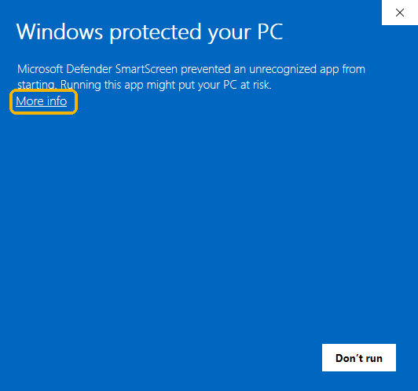
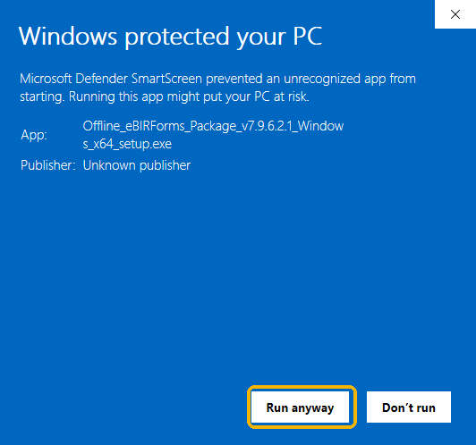
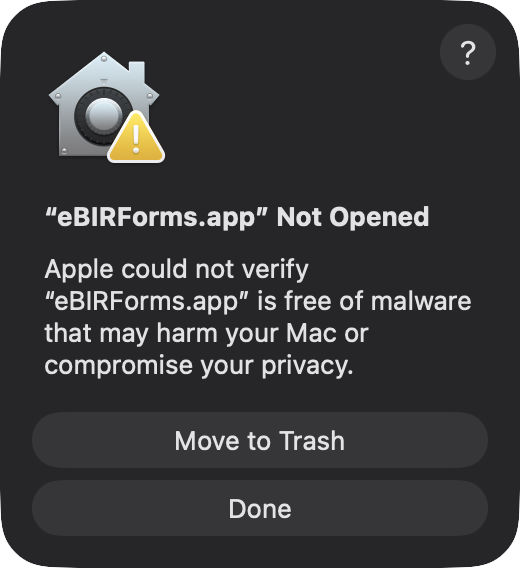
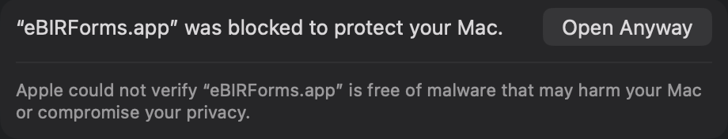
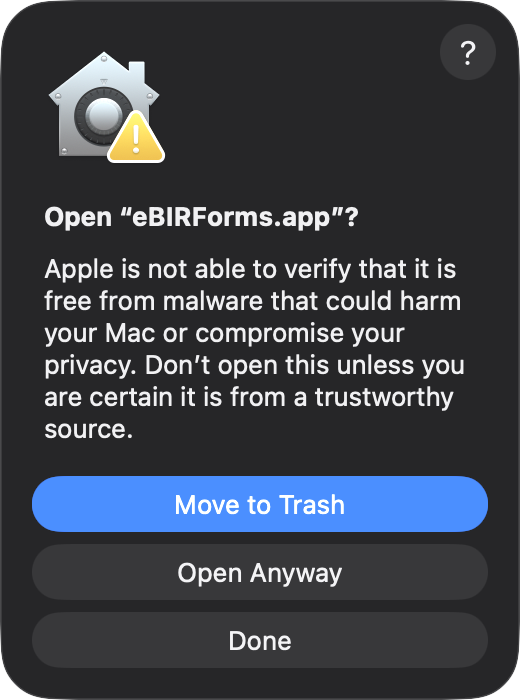

BIR's Offline eBIRForms Package, rebuilt to run on Windows, macOS and Linux. Fill in, save and print BIR's 84
forms offline. The saved files are the same as BIR's own app makes. This app is free and not affiliated with BIR.

## Which file do I download?

| Your computer | Download |
|---|---|
| Windows 10 or 11 | `..._Windows_x64_setup.exe` |
| Mac (Apple Silicon or Intel), macOS 12 or later | `..._macOS_universal.dmg` |
| Ubuntu, Debian, Linux Mint | `..._Linux_amd64.deb` |
| Any other Linux | `..._Linux_x86_64.AppImage` |

## Windows

1. Open the `setup.exe` you downloaded.
2. If Windows shows **Windows protected your PC**, click **More info**, then **Run anyway**. Windows shows this for
   new apps that are not signed yet.

    

3. Click **Next** until you see **Install**, then **Install** and **Finish**. You don't need an administrator
   account.

## Mac

1. Open the `.dmg` and drag **eBIRForms** into **Applications**.
2. Open eBIRForms. macOS stops it the first time. Click **Done**.

   

3. Open **System Settings**, then **Privacy & Security**. Scroll down and click **Open Anyway**.

   

4. Click the grey **Open Anyway** (not the blue Move to Trash), then enter your Mac password.

   

You only do this once. On macOS 12 to 14, you can instead right-click eBIRForms in Applications and choose **Open**.

## Linux

- **`.deb`** (Ubuntu, Debian, Mint): in a terminal, in the folder you downloaded it to, run
  `sudo apt install ./Offline_eBIRForms_Package_*_Linux_amd64.deb`. Then open eBIRForms from your app list.
- **`.AppImage`** (any distribution): right-click the file, open **Properties**, and turn on **Allow executing file
  as program** (or run `chmod +x` on it). Then double-click it.

## After installing

Fill in your profile, pick a form, click **Fill-up**, and **Save**, the same as in BIR's app. Found a problem?
[Open an issue](https://github.com/betterebirforms/ebirforms/issues/new/choose).
