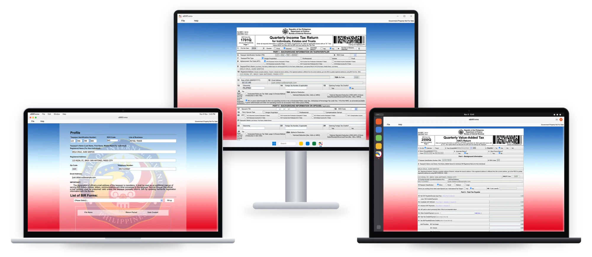

  

<h1 align="center">eBIRForms</h1>

  Ang Offline eBIRForms Package sa BIR, gihimo pag-usab aron modagan nga native sa <b>macOS, Windows ug Linux</b>. 
  Tanan nga 84 ka tax form sa BIR, offline, ug ang mga savefile maablihan usab sa kaugalingong app sa BIR.

  
  
  
  
  
  

  <a href="README.md">English</a> · <a href="README.fil.md">Filipino</a> · <b>Cebuano</b>

  

> Dili opisyal. Walay kalabutan sa, ug wala gi-endorso sa, Bureau of Internal Revenue (BIR).

## I-download

Kuhaa ang file para sa imong computer sa **[pinakabag-ong release](https://github.com/betterebirforms/ebirforms/releases/latest)**.

| Imong computer | File |
|---|---|
| Mac (Apple Silicon o Intel) | `Offline_eBIRForms_Package_v7.9.6.2.1_macOS_universal.dmg` |
| Windows 10 o 11 (64-bit) | `Offline_eBIRForms_Package_v7.9.6.2.1_Windows_x64_setup.exe` |
| Linux (64-bit) | `..._Linux_x86_64.AppImage` o `..._Linux_amd64.deb` |

## Compatibility

| Bahin | Gisuportahan |
|---|---|
| BIR package | v7.9.6.2.1 (BIR Revenue Memorandum Circular No. 104-2026): tanan nga 84 ka form, lakip ang bag-ong mga code sa 0605 para sa micro taxpayers |
| macOS | 12 Monterey o mas bag-o |
| Windows | 10 o 11, 64-bit |
| Linux | Ubuntu 22.04 o mas bag-o, o susama |
| Mga savefile | Parehas nga format sa Windows app sa BIR, mao nga maablihan ang file sa bisan asa |
| Online Submit | Wala sa download build |
| Status | Beta |

## Pag-install

- **Mac:** ablihi ang `.dmg` ug i-drag ang **eBIRForms** ngadto sa Applications. Sa unang pag-abli, babagan kini sa
  macOS kay wala pa ma-notarize ang app. I-click ang **Done**, adto sa **System Settings > Privacy & Security**, ug
  i-click ang **Open Anyway**, dayon ang abuhon nga **Open Anyway** (dili ang asul) ug ang password sa imong Mac. Sa macOS 12 hangtod 14, i-right-click ang app ug pilia ang **Open**.
- **Windows:** padagana ang setup `.exe`. Kung motungha ang SmartScreen, i-click ang **More info**, dayon
  **Run anyway**.
- **Linux:** himoang executable ang `.AppImage` (`chmod +x`) ug padagana kini, o i-install ang `.deb` gamit ang
  `sudo apt install ./..._amd64.deb`.

Adunay mga hulagway sa matag lakang sa [download page](https://github.com/betterebirforms/ebirforms/releases/latest).

Human niana, sulati ang imong profile, pagpili og form, i-click ang **Fill-up**, ug **Save**, sama sa app sa BIR.

## Mga link

- Problema o pangutana: [Issues](https://github.com/betterebirforms/ebirforms/issues)
- Mga kausaban: [CHANGELOG.md](CHANGELOG.md)
- Tabang sa paghimo: [CONTRIBUTING.md](CONTRIBUTING.md) (setup, han-ay sa repo, mga lagda)
- Usba ang lihok sa usa ka form, o patya ang among mga ayo: [mods](mod/README.md)
- Mga plano, apil ang mobile ug web: [ROADMAP.md](ROADMAP.md)
- Unsaon kini paglihok: [docs/architecture.md](docs/architecture.md)

Ang mga form sa BIR mga buhat sa Gobyerno sa Pilipinas (ang Intellectual Property Code, RA 8293 §176.1). Ang logo gibase sa selyo sa BIR.

Code: [MIT License](LICENSE). Dili apil niini ang mga form ug artwork sa BIR; tan-awa ang [NOTICE.md](NOTICE.md).
