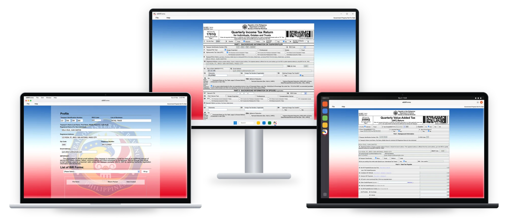

  

<h1 align="center">eBIRForms</h1>

  Ang Offline eBIRForms Package sa BIR, gihimo pag-usab para sa <b>Mac, Windows, Linux ug sa imong web browser</b>. 
  Tanan nga 84 ka tax form sa BIR. Sulati, susiha, i-save, i-print ug ipadala ang imong return, ug maablihan ang mga file sa kaugalingong app sa BIR.

  
  

  
  
  
  

  <a href="README.md">English</a> · <a href="README.fil.md">Filipino</a> · <b>Cebuano</b>

  

> Dili opisyal. Walay kalabutan sa, ug wala gi-endorso sa, Bureau of Internal Revenue (BIR).

## Duha ka paagi sa paggamit

| | Desktop app | Web version |
|---|---|---|
| Asa | Mac, Windows, Linux | Bisan unsang browser: [betterebirforms.github.io/ebirforms](https://betterebirforms.github.io/ebirforms/) |
| Install | Oo, [i-download](https://github.com/betterebirforms/ebirforms/releases/latest) | Dili. Molihok offline human sa unang bisita |
| Mga form | Ang 84 ka form sa BIR, sama sa app sa BIR | Ang parehas nga 84 ka form, sa kaugalingong page layout sa BIR |
| Imong mga return | Anaa sa imong computer | Anaa sa imong browser, o sa folder nga imong pilion (Chrome, Edge) |
| Pagpadala sa BIR | **Oo** (beta), gamit ang Submit | Dili. Maghimo ang Submit og naka-lock nga final copy sa BIR; ipadala kini gikan sa desktop app o sa app sa BIR |
| Updates | Kusa nga mag-update ang app | Kanunay pinakabag-o |

Parehas silang mag-save sa parehas nga file sama sa Windows app sa BIR, mao nga maablihan ang return sa bisan asa sa tulo.

## Pag-file sa imong return

1. Sulati ang imong profile, pagpili og form, i-click ang **Fill-up**.
2. Sulati ang form ug i-click ang **Validate**. Kung mopasar, ma-lock ang form. Ablihan kini pag-usab sa **Edit**.
3. I-click ang **Submit / Final Copy**.
   - **Desktop app:** ipadala niini ang return ngadto sa BIR, sama sa kaugalingong app sa BIR. Naka-on ang
     pagpadala sa sinugdanan; mahimo nimo kining i-off sa **Go > Send Returns to BIR (beta)**.
   - **Web version:** dili makaabli ang web page sa upload connection sa BIR, mao nga i-save niini ang naka-lock nga
     final copy sa BIR. Ablihi kanang file sa desktop app o sa eBIRForms sa BIR sa Windows ug i-click ang Submit
     didto, o i-print kini.
4. **Na-file ra ang imong return kung moabot na ang confirmation email sa BIR.** Tipigi kanang email isip pamatuod.

Beta pa ang pagpadala. Wala pay return nga gipadala niining app nga nakumpirma sa BIR. Unsaon kini paglihok: inig
abli sa app nga adunay internet, i-download niini kausa ang opisyal nga package sa BIR gikan sa bir.gov.ph ug duha
ra ka file ang tipigan. Sama sa app sa BIR, pangutan-on una niini ang server sa BIR kung asa mag-upload, pinaagi sa
plain HTTP (walay HTTPS ang server sa BIR), apil ang imong TIN (walay branch code). Susihon ang tubag ug dili
padaganon, ug ang return mismo moagi sa SFTP.

## I-download

Kuhaa ang file para sa imong computer sa **[pinakabag-ong release](https://github.com/betterebirforms/ebirforms/releases/latest)**.

| Imong computer | File |
|---|---|
| Mac (Apple Silicon o Intel), macOS 12 o mas bag-o | `Offline_eBIRForms_Package_v7.9.6.2.1_macOS_universal.dmg` |
| Windows 10 o 11 (64-bit) | `Offline_eBIRForms_Package_v7.9.6.2.1_Windows_x64_setup.exe` |
| Linux (64-bit), Ubuntu 22.04 o mas bag-o | `..._Linux_x86_64.AppImage` o `..._Linux_amd64.deb` |

## Pag-install

- **Mac:** ablihi ang `.dmg` ug i-drag ang **eBIRForms** ngadto sa Applications. Sa unang pag-abli, babagan kini sa
  macOS kay wala pa ma-notarize ang app. I-click ang **Done**, adto sa **System Settings > Privacy & Security**, ug
  i-click ang **Open Anyway**, dayon ang abuhon nga **Open Anyway** (dili ang asul) ug ang password sa imong Mac. Sa macOS 12 hangtod 14, i-right-click ang app ug pilia ang **Open**.
- **Windows:** padagana ang setup `.exe`. Kung motungha ang SmartScreen, i-click ang **More info**, dayon
  **Run anyway**.
- **Linux:** himoang executable ang `.AppImage` (`chmod +x`) ug padagana kini, o i-install ang `.deb` gamit ang
  `sudo apt install ./..._amd64.deb`.

Adunay mga hulagway sa matag lakang sa [download page](https://github.com/betterebirforms/ebirforms/releases/latest).
Human niana, mosusi ang app og update matag abli; **Updates > Check for Updates** aron mosusi karon. Adunay pirma ang matag update.

## Unsay sakop

| Bahin | Gisuportahan |
|---|---|
| BIR package | v7.9.6.2.1 (BIR Revenue Memorandum Circular No. 104-2026): tanan nga 84 ka form, lakip ang bag-ong mga code sa 0605 para sa micro taxpayers |
| Mga savefile | Parehas nga format sa Windows app sa BIR, mao nga maablihan ang file sa bisan asa |
| Help | Ang kaugalingong help page sa BIR para sa matag form, sa **Help** |
| Status | Beta |

## Suportahi ang proyekto

Libre ug open source ang eBIRForms. Kung nakatipig ka og biyahe paingon sa usa ka Windows PC, mahimo nimo kaming ilibre og kape.

  
   
  Modawat ang Ko-fi og PayPal ug card. Anaa usab ang link sa <b>Support > Donate</b> sa app, ug sa home screen sa web version.

## Mga link

- Problema o pangutana: [Issues](https://github.com/betterebirforms/ebirforms/issues)
- Mga kausaban: [CHANGELOG.md](CHANGELOG.md)
- Tabang sa paghimo: [CONTRIBUTING.md](CONTRIBUTING.md) (setup, han-ay sa repo, mga lagda)
- Usba ang lihok sa usa ka form, o patya ang among mga ayo: [mods](mod/README.md), o **Go > Mods** sa app
- Tugoti ang usa ka AI agent (Claude, Codex) nga mopuno ug mo-save og draft: [docs/agent.md](docs/agent.md)
- Mga plano, apil ang mga phone: [ROADMAP.md](ROADMAP.md)
- Unsaon kini paglihok: [docs/architecture.md](docs/architecture.md)

Ang mga form sa BIR mga buhat sa Gobyerno sa Pilipinas (ang Intellectual Property Code, RA 8293 §176.1). Ang logo gibase sa selyo sa BIR.

Code: [MIT License](LICENSE). Dili apil niini ang mga form ug artwork sa BIR; tan-awa ang [NOTICE.md](NOTICE.md).
