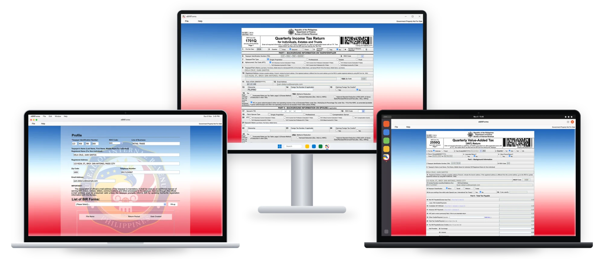

  

<h1 align="center">eBIRForms</h1>

  Ang Offline eBIRForms Package ng BIR, ginawang muli para sa <b>Mac, Windows, Linux at sa iyong web browser</b>. 
  Lahat ng 84 na tax form ng BIR. Punan, suriin, i-save, i-print at ipadala ang iyong return, at nabubuksan ang mga file sa sariling app ng BIR.

  
  

  
  
  
  

  <a href="README.md">English</a> · <b>Filipino</b> · <a href="README.ceb.md">Cebuano</a>

  

> Hindi opisyal. Walang kaugnayan sa, at hindi inendorso ng, Bureau of Internal Revenue (BIR).

## Dalawang paraan ng paggamit

| | Desktop app | Web version |
|---|---|---|
| Saan | Mac, Windows, Linux | Kahit anong browser: [betterebirforms.github.io/ebirforms](https://betterebirforms.github.io/ebirforms/) |
| Install | Oo, [i-download](https://github.com/betterebirforms/ebirforms/releases/latest) | Hindi. Gumagana offline pagkatapos ng unang bisita |
| Mga form | Ang 84 na form ng BIR, gaya ng sa app ng BIR | Ang parehong 84 na form, sa sariling page layout ng BIR |
| Mga return mo | Nasa computer mo | Nasa browser mo, o sa folder na pipiliin mo (Chrome, Edge) |
| Pagpapadala sa BIR | **Oo** (beta), gamit ang Submit | Hindi. Gumagawa ang Submit ng naka-lock na final copy ng BIR; ipadala ito mula sa desktop app o sa app ng BIR |
| Updates | Kusang nag-a-update ang app | Laging pinakabago |

Pareho silang nagse-save ng parehong file gaya ng Windows app ng BIR, kaya nabubuksan ang return sa alinman sa tatlo.

## Pag-file ng return mo

1. Punan ang profile mo, pumili ng form, i-click ang **Fill-up**.
2. Punan ang form at i-click ang **Validate**. Kapag pumasa, nala-lock ang form. Binubuksan ito ulit ng **Edit**.
3. I-click ang **Submit / Final Copy**.
   - **Desktop app:** ipinapadala nito ang return sa BIR, gaya ng sariling app ng BIR. Naka-on ang pagpapadala sa
     simula; maaari mo itong i-off sa **Go > Send Returns to BIR (beta)**.
   - **Web version:** hindi makapagbukas ang web page ng upload connection ng BIR, kaya sine-save nito ang naka-lock
     na final copy ng BIR. Buksan ang file na iyon sa desktop app o sa eBIRForms ng BIR sa Windows at i-click ang
     Submit doon, o i-print ito.
4. **Naka-file lang ang return mo kapag dumating na ang confirmation email ng BIR.** Itabi ang email na iyon bilang patunay.

Beta pa ang pagpapadala. Wala pang return na ipinadala ng app na ito ang nakumpirma ng BIR. Paano ito gumagana:
kapag nagbukas ang app nang may internet, dina-download nito nang isang beses ang opisyal na package ng BIR mula sa
bir.gov.ph at dalawang file lang ang itinatabi. Gaya ng app ng BIR, tinatanong muna nito ang server ng BIR kung saan
mag-a-upload, gamit ang plain HTTP (walang HTTPS ang server ng BIR), kasama ang TIN mo (walang branch code). Sinusuri
ang sagot at hindi pinapatakbo, at ang return mismo ay dumadaan sa SFTP.

## I-download

Kunin ang file para sa iyong computer sa **[pinakabagong release](https://github.com/betterebirforms/ebirforms/releases/latest)**.

| Iyong computer | File |
|---|---|
| Mac (Apple Silicon o Intel), macOS 12 o mas bago | `Offline_eBIRForms_Package_v7.9.6.2.1_macOS_universal.dmg` |
| Windows 10 o 11 (64-bit) | `Offline_eBIRForms_Package_v7.9.6.2.1_Windows_x64_setup.exe` |
| Linux (64-bit), Ubuntu 22.04 o mas bago | `..._Linux_x86_64.AppImage` o `..._Linux_amd64.deb` |

## Pag-install

- **Mac:** buksan ang `.dmg` at i-drag ang **eBIRForms** sa Applications. Sa unang pagbukas, haharangin ito ng macOS
  dahil hindi pa notarized ang app. I-click ang **Done**, pumunta sa **System Settings > Privacy & Security**, at
  i-click ang **Open Anyway**, pagkatapos ang kulay-abong **Open Anyway** (hindi ang asul) at ang password ng Mac mo. Sa macOS 12 hanggang 14, i-right-click ang app at piliin ang **Open**.
- **Windows:** patakbuhin ang setup `.exe`. Kung lumabas ang SmartScreen, i-click ang **More info**, tapos
  **Run anyway**.
- **Linux:** gawing executable ang `.AppImage` (`chmod +x`) at patakbuhin ito, o i-install ang `.deb` gamit ang
  `sudo apt install ./..._amd64.deb`.

May mga larawan ng bawat hakbang sa [download page](https://github.com/betterebirforms/ebirforms/releases/latest).
Pagkatapos, tumitingin ang app ng update tuwing binubuksan; **Updates > Check for Updates** para tumingin ngayon. May pirma ang bawat update.

## Saklaw

| Bahagi | Suportado |
|---|---|
| BIR package | v7.9.6.2.1 (BIR Revenue Memorandum Circular Blg. 104-2026): lahat ng 84 na form, kasama ang mga bagong code ng 0605 para sa micro taxpayers |
| Mga savefile | Parehong format ng Windows app ng BIR, kaya nabubuksan ang file sa alinman |
| Help | Ang sariling help page ng BIR para sa bawat form, sa **Help** |
| Status | Beta |

## Suportahan ang proyekto

Libre at open source ang eBIRForms. Kung nakatipid ka ng biyahe papunta sa isang Windows PC, maaari mo kaming ilibre ng kape.

  
   
  Tumatanggap ang Ko-fi ng PayPal at card. Nasa <b>Support > Donate</b> din ang link sa app, at sa home screen ng web version.

## Mga link

- Problema o tanong: [Issues](https://github.com/betterebirforms/ebirforms/issues)
- Mga pagbabago: [CHANGELOG.md](CHANGELOG.md)
- Tumulong sa pagbuo: [CONTRIBUTING.md](CONTRIBUTING.md) (setup, ayos ng repo, mga patakaran)
- Baguhin ang kilos ng isang form, o patayin ang aming mga ayos: [mods](mod/README.md), o **Go > Mods** sa app
- Hayaang mag-fill at mag-save ng draft ang isang AI agent (Claude, Codex): [docs/agent.md](docs/agent.md)
- Mga plano, kasama ang mga phone: [ROADMAP.md](ROADMAP.md)
- Paano ito gumagana: [docs/architecture.md](docs/architecture.md)

Ang mga form ng BIR ay gawa ng Pamahalaan ng Pilipinas (ang Intellectual Property Code, RA 8293 §176.1). Ang logo ay hango sa selyo ng BIR.

Code: [MIT License](LICENSE). Hindi sakop nito ang mga form at artwork ng BIR; tingnan ang [NOTICE.md](NOTICE.md).
