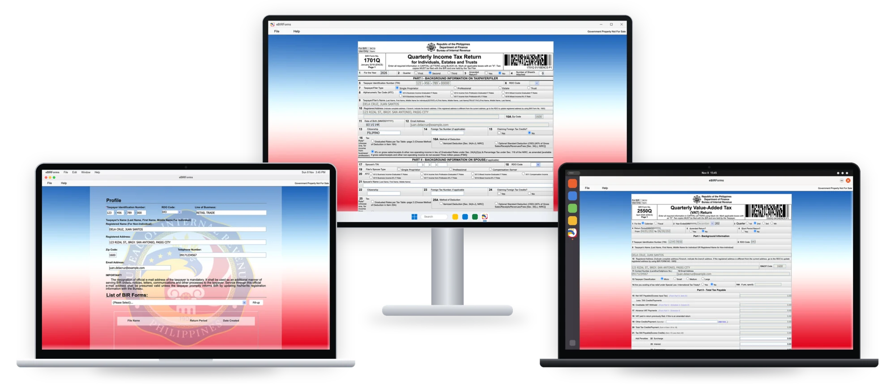

  

<h1 align="center">eBIRForms</h1>

  BIR's Offline eBIRForms Package, rebuilt for <b>Mac, Windows, Linux and your web browser</b>. 
  All 84 BIR tax forms. Fill in, check, save, print and send your return, with files that open in BIR's own app.

  
  

  
  
  
  

  <b>English</b> · <a href="README.fil.md">Filipino</a> · <a href="README.ceb.md">Cebuano</a>

  

> Unofficial. Not affiliated with or endorsed by the Bureau of Internal Revenue (BIR).

## Two ways to use it

| | Desktop app | Web version |
|---|---|---|
| Where | Mac, Windows, Linux | Any browser: [betterebirforms.github.io/ebirforms](https://betterebirforms.github.io/ebirforms/) |
| Install | Yes, [download](https://github.com/betterebirforms/ebirforms/releases/latest) | No. Works offline after the first visit |
| Forms | BIR's 84 forms, as in BIR's app | The same 84 forms on BIR's own page layout |
| Your returns | On your computer | In your browser, or in a folder you pick (Chrome, Edge) |
| Sending to BIR | **Yes** (beta), with Submit | No. Submit makes BIR's locked final copy; send it from the desktop app or BIR's app |
| Updates | The app updates itself | Always the latest |

Both save the same files as BIR's Windows app, so a return opens in any of the three.

## Filing your return

1. Fill in your profile, pick a form, click **Fill-up**.
2. Fill in the form and click **Validate**. When it passes, the form locks. **Edit** opens it again.
3. Click **Submit / Final Copy**.
   - **Desktop app:** it sends the return to BIR, the way BIR's own app does. Sending is on by default; you can turn
     it off in **Go > Send Returns to BIR (beta)**.
   - **Web version:** a web page can't open BIR's upload connection, so it saves BIR's locked final copy instead.
     Open that file in the desktop app or in BIR's eBIRForms on Windows and click Submit there, or print it.
4. **Your return is filed only when BIR's confirmation email arrives.** Keep that email as your proof.

Sending is in beta. No return sent by this app has been confirmed by BIR yet. How it works: when the app starts with
an internet connection, it downloads BIR's official package from bir.gov.ph once and keeps two files from it. Like
BIR's app, it first asks BIR's server where to upload, over plain HTTP (BIR's server offers no HTTPS), with your TIN
(without the branch code). The answer is checked, never run, and the return itself goes over SFTP.

## Download

Get the file for your computer from the **[latest release](https://github.com/betterebirforms/ebirforms/releases/latest)**.

| Your computer | File |
|---|---|
| Mac (Apple Silicon or Intel), macOS 12 or later | `Offline_eBIRForms_Package_v7.9.6.2.1_macOS_universal.dmg` |
| Windows 10 or 11 (64-bit) | `Offline_eBIRForms_Package_v7.9.6.2.1_Windows_x64_setup.exe` |
| Linux (64-bit), Ubuntu 22.04 or later | `..._Linux_x86_64.AppImage` or `..._Linux_amd64.deb` |

## Install

- **Mac:** open the `.dmg` and drag **eBIRForms** to Applications. The first time you open it, macOS blocks it
  because the app is not notarized. Click **Done**, then go to **System Settings > Privacy & Security** and click
  **Open Anyway**, then the grey **Open Anyway** button (not the blue one) and your Mac password. On macOS 12 to 14, right-click the app and choose **Open** instead.
- **Windows:** run the setup `.exe`. If SmartScreen appears, click **More info**, then **Run anyway**.
- **Linux:** make the `.AppImage` executable (`chmod +x`) and run it, or install the `.deb` with
  `sudo apt install ./..._amd64.deb`.

Step-by-step pictures for each system are on the [download page](https://github.com/betterebirforms/ebirforms/releases/latest).
After that, the app checks for updates when it opens; **Updates > Check for Updates** checks now. Each update is signed.

## What it covers

| Item | Supported |
|---|---|
| BIR package | v7.9.6.2.1 (BIR Revenue Memorandum Circular No. 104-2026): all 84 forms, including the new 0605 codes for micro taxpayers |
| Savefiles | Same format as BIR's Windows app, so a file opens in either |
| Help | BIR's own help page for each form, under **Help** |
| Status | Beta |

## Support this project

eBIRForms is free and open source. If it saved you a trip to a Windows PC, you can buy us a coffee.

  
   
  Ko-fi takes PayPal and cards. The same link is under <b>Support > Donate</b> in the app and on the web version's home screen.

## Links

- Problems or questions: [Issues](https://github.com/betterebirforms/ebirforms/issues)
- What changed: [CHANGELOG.md](CHANGELOG.md)
- Help build it: [CONTRIBUTING.md](CONTRIBUTING.md) (setup, how the repo is laid out, the rules)
- Change how a form behaves, or switch our fixes off: [mods](mod/README.md), or **Go > Mods** in the app
- Let an AI agent (Claude, Codex) fill and save draft returns: [docs/agent.md](docs/agent.md)
- What's planned, including phones: [ROADMAP.md](ROADMAP.md)
- How it works: [docs/architecture.md](docs/architecture.md)

BIR's forms are works of the Philippine Government (the Intellectual Property Code, RA 8293 §176.1). The logo is adapted from BIR's seal.

Code: [MIT License](LICENSE). BIR's forms and artwork are not covered by it; see [NOTICE.md](NOTICE.md).
